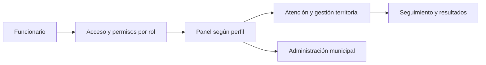

# SGR · Gestión Municipal La Serena

Portal web para organizar la atención ciudadana y el trabajo territorial de la Ilustre Municipalidad de La Serena. Reúne la operación diaria, el seguimiento de resultados y la administración de accesos en una misma plataforma.

<p align="center">
  <strong>Atención ciudadana · Gestión territorial · Seguimiento de resultados</strong><br>
  Proyecto Integrado — Municipalidad de La Serena, Chile
</p>

## El proyecto

El Sistema de Gestión de Resultados (SGR) conecta a funcionarios, delegaciones y equipos municipales mediante flujos de trabajo con permisos por rol. Cada persona accede con su cuenta y ve su identidad institucional; las cuentas operativas quedan acotadas a la delegación asignada, mientras la administración central mantiene la vista comunal.



## Módulos

| Área | Qué permite hacer |
|---|---|
| Paneles por perfil | Consultar la información y las herramientas correspondientes al rol asignado. |
| Atención ciudadana | Registrar casos y actividades con su delegación, tipo de atención y antecedentes. |
| Delegaciones y personal | Mantener delegaciones, cargos, usuarios y roles desde la administración autorizada. |
| Metas e indicadores | Organizar objetivos y revisar avances de gestión. |
| Evidencias y auditoría | Acompañar registros con respaldos y mantener trazabilidad de cambios. |
| Acceso y recuperación | Iniciar sesión con las credenciales de la cuenta y solicitar recuperación mediante código por correo. |

## Cómo está construido

- **Servidor:** Python y Django.
- **Interfaz:** plantillas HTML, CSS y JavaScript, con componentes de Bootstrap.
- **Persistencia local:** SQLite para desarrollo y pruebas.
- **Base prevista para despliegue:** MySQL, configurada por variables de entorno.
- **Control de versiones:** Git.

## Ejecutar en local

Requiere Python instalado y Git para clonar el repositorio. Desde Git Bash:

```bash
git clone https://github.com/KevinInacap/proyectointegrado.git
cd proyectointegrado
python -m venv .venv
source .venv/Scripts/activate
pip install -r requirements.txt
python manage.py migrate
python manage.py seed_data
python manage.py runserver
```

Abre <http://127.0.0.1:8000/>. `seed_data` prepara los catálogos institucionales sin crear cuentas ni actividad ficticia. Para acceder, usa una cuenta creada por el administrador del entorno; este repositorio no publica contraseñas ni credenciales compartidas.

En Windows PowerShell, activa el entorno con:

```powershell
.venv\Scripts\Activate.ps1
```

## Configuración

La aplicación toma sus parámetros desde variables de entorno. `.env.example` muestra los nombres disponibles; copia sus valores a un `.env` local y define una clave privada de Django, base de datos y correo según el entorno. El archivo `.env` está excluido de Git: no publiques claves, contraseñas ni datos personales.

El proyecto ya incluye el controlador `mysqlclient` y admite MySQL con `DB_ENGINE=mysql`, `DB_NAME`, `DB_USER`, `DB_PASSWORD`, `DB_HOST` y `DB_PORT`. Antes de cambiar el motor, configura una cuenta MySQL con permisos sobre una base vacía y respalda la base actual. Después aplica `python manage.py migrate`; mover registros de SQLite a MySQL requiere exportarlos e importarlos por separado. No cambies el `.env` compartido ni subas credenciales al repositorio.

El esquema SQL de `database/` es material de referencia académica, no una herramienta de actualización. Para preparar una base usa las migraciones de Django; no ejecutes el esquema de referencia sobre una base con información.

## Pruebas

Para una presentación local con datos ficticios, ejecuta `python manage.py seed_presentation` después de las migraciones. Agrega tres ejemplos por catálogo y puede repetirse sin duplicarlos. Los perfiles de ejemplo están inactivos y no tienen contraseña de acceso; no reemplaza usuarios, cargos ni permisos existentes. Solo está habilitado en desarrollo (`DEBUG`).

```bash
python manage.py check
python manage.py makemigrations --check --dry-run
python manage.py test
```

La configuración local no certifica un despliegue en AWS. Antes de alojar el sistema se deben definir y comprobar la instancia, MySQL, correo, dominio, seguridad de producción y respaldos.

---

**Ilustre Municipalidad de La Serena · Proyecto Integrado**
