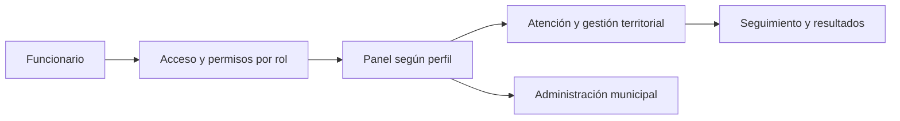

# SGR · Gestión Municipal La Serena

Portal web para organizar la atención ciudadana y el trabajo territorial de la Ilustre Municipalidad de La Serena. Reúne la operación diaria, el seguimiento de resultados y la administración de accesos en una misma plataforma.

<p align="center">
  <strong>Atención ciudadana · Gestión territorial · Seguimiento de resultados</strong><br>
  Proyecto Integrado — Municipalidad de La Serena, Chile
</p>

## El proyecto

El Sistema de Gestión de Resultados (SGR) conecta a funcionarios, delegaciones y equipos municipales mediante flujos de trabajo con permisos por rol. Cada persona accede con su cuenta y ve su identidad institucional; las cuentas operativas quedan acotadas a la delegación asignada, mientras la administración central mantiene la vista comunal.



## Módulos

| Área | Qué permite hacer |
|---|---|
| Paneles por perfil | Consultar la información y las herramientas correspondientes al rol asignado. |
| Atención ciudadana | Registrar casos y actividades con su delegación, tipo de atención y antecedentes. |
| Delegaciones y personal | Mantener delegaciones, cargos, usuarios y roles desde la administración autorizada. |
| Metas e indicadores | Organizar objetivos y revisar avances de gestión. |
| Evidencias y auditoría | Acompañar registros con respaldos y mantener trazabilidad de cambios. |
| Acceso y recuperación | Iniciar sesión con las credenciales de la cuenta y solicitar recuperación mediante código por correo. |

## Cómo está construido

- **Servidor:** Python y Django.
- **Interfaz:** plantillas HTML, CSS y JavaScript, con componentes de Bootstrap.
- **Persistencia:** SQLite para un inicio rápido o MySQL mediante variables de entorno. Las pruebas locales de esta entrega se ejecutaron con MySQL.
- **Control de versiones:** Git.

## Ejecutar en local

Requiere Python 3.12 o superior y Git para clonar el repositorio. Desde Git Bash:

```bash
git clone https://github.com/KevinInacap/proyectointegrado.git
cd proyectointegrado
python -m venv .venv
source .venv/Scripts/activate
pip install -r requirements.txt
cp .env.example .env
python manage.py migrate
python manage.py seed_data
python manage.py runserver
```

Abre <http://127.0.0.1:8000/>. `seed_data` prepara los catálogos institucionales sin crear cuentas ni actividad ficticia. Para acceder, usa una cuenta creada por el administrador del entorno; este repositorio no publica contraseñas ni credenciales compartidas.

Si ya tenías una copia del proyecto, ejecuta `git pull origin main` antes de copiar `.env.example`: la clave de ejemplo para desarrollo se agregó recientemente. Conserva tu `.env` existente si ya tiene una configuración propia.

Si prefieres Windows PowerShell, ejecuta el equivalente sin activar el entorno (así no dependes de la política de ejecución):

```powershell
git clone https://github.com/KevinInacap/proyectointegrado.git
Set-Location proyectointegrado
py -m venv .venv
.\.venv\Scripts\python.exe -m pip install -r requirements.txt
Copy-Item .env.example .env
.\.venv\Scripts\python.exe manage.py migrate
.\.venv\Scripts\python.exe manage.py seed_data
.\.venv\Scripts\python.exe manage.py runserver
```

## Configuración

La aplicación toma sus parámetros desde variables de entorno. El ejemplo permite arrancar localmente con SQLite y una clave **solo de desarrollo**; cada persona debe copiarlo a su propio `.env`. No copies el `.env` de AWS ni subas claves o contraseñas a Git. Para un servidor, cambia `DEBUG=False`, usa una `SECRET_KEY` aleatoria privada y configura la base y el correo del entorno.

El proyecto ya incluye el controlador `mysqlclient` y admite MySQL con `DB_ENGINE=mysql`, `DB_NAME`, `DB_USER`, `DB_PASSWORD`, `DB_HOST` y `DB_PORT`. Antes de cambiar el motor, configura una cuenta MySQL con permisos sobre una base vacía y respalda la base actual. Después aplica `python manage.py migrate`; mover registros de SQLite a MySQL requiere exportarlos e importarlos por separado. No cambies el `.env` compartido ni subas credenciales al repositorio.

## Actualizar la instancia AWS

Subir cambios a GitHub no cambia automáticamente la instancia. En EC2 Instance Connect, la primera vez trae este procedimiento con `cd ~/proyectointegrado && git pull --ff-only origin main` y luego ejecuta el comando siguiente. Para cada versión posterior publicada en `main`, basta con el mismo comando:

```bash
cd ~/proyectointegrado && bash scripts/deploy_aws.sh
```

El comando rechaza cambios locales en archivos versionados, exige una actualización directa, respalda MariaDB y `.env` en una carpeta privada, instala dependencias si cambiaron, aplica migraciones, reúne archivos estáticos y reinicia el portal. Al final comprueba que la página responda. Si falla, conserva el respaldo e informa el error; no borra datos ni fuerza la rama. En AWS Academy es preferible este despliegue controlado a dejar una clave SSH de la instancia en GitHub para ejecutar cada push automáticamente.

El correo de recuperación requiere una clave de aplicación de Gmail **solo en el servidor**. Para configurarlo una vez, ejecuta `./.venv/bin/python scripts/configure_smtp_account.py` desde la carpeta del proyecto en EC2 Instance Connect e introduce allí la clave cuando la pida. El programa no la muestra, prueba un envío a la cuenta remitente, guarda la configuración en el `.env` privado y reinicia el portal. No pegues esa clave en GitHub ni en el chat. Comprueba que llegue el mensaje de prueba y después solicita un código real de recuperación.

La IP pública actualmente usa HTTP: hasta que se configure HTTPS, no es adecuado introducir credenciales reales por esa conexión.

El esquema SQL de `database/` es material de referencia académica, no una herramienta de actualización. Para preparar una base usa las migraciones de Django; no ejecutes el esquema de referencia sobre una base con información.

## Pruebas

Para una presentación local con datos ficticios, ejecuta `python manage.py seed_presentation` después de las migraciones. Agrega tres ejemplos por catálogo y puede repetirse sin duplicarlos. Los perfiles de ejemplo están inactivos y no tienen contraseña de acceso; no reemplaza usuarios, cargos ni permisos existentes. Solo está habilitado en desarrollo (`DEBUG`).

Si necesitas una dotación de ensayo, `python manage.py seed_academic_users` agrega cinco cuentas ficticias por cada una de las seis delegaciones, con correos `@pnk.cl`. Es idempotente y solo funciona en desarrollo. Las cuentas no tienen contraseña utilizable hasta que un administrador se la asigne; no son identidades reales ni deben enviarse correos a ellas.

```bash
python manage.py check
python manage.py makemigrations --check --dry-run
python manage.py test
```

La configuración local no certifica un despliegue en AWS. Antes de alojar el sistema se deben definir y comprobar la instancia, MySQL, correo, dominio, seguridad de producción y respaldos.

El registro de pruebas y los pendientes exactos de la segunda evaluación están en [Verificación de la segunda evaluación](docs/VERIFICACION_SEGUNDA_EVALUACION.md).

La revisión del panel de administración y las referencias para futuras mejoras de animación están en [Referencias y auditoría del panel](docs/REFERENCIAS_ANIMACIONES_Y_AUDITORIA_ADMIN.md). Los antecedentes funcionales y sus pendientes se encuentran en [Revisión de los archivos de octubre](docs/REVISION_ADJUNTOS_OCTUBRE_2026.md).

---

**Ilustre Municipalidad de La Serena · Proyecto Integrado**
